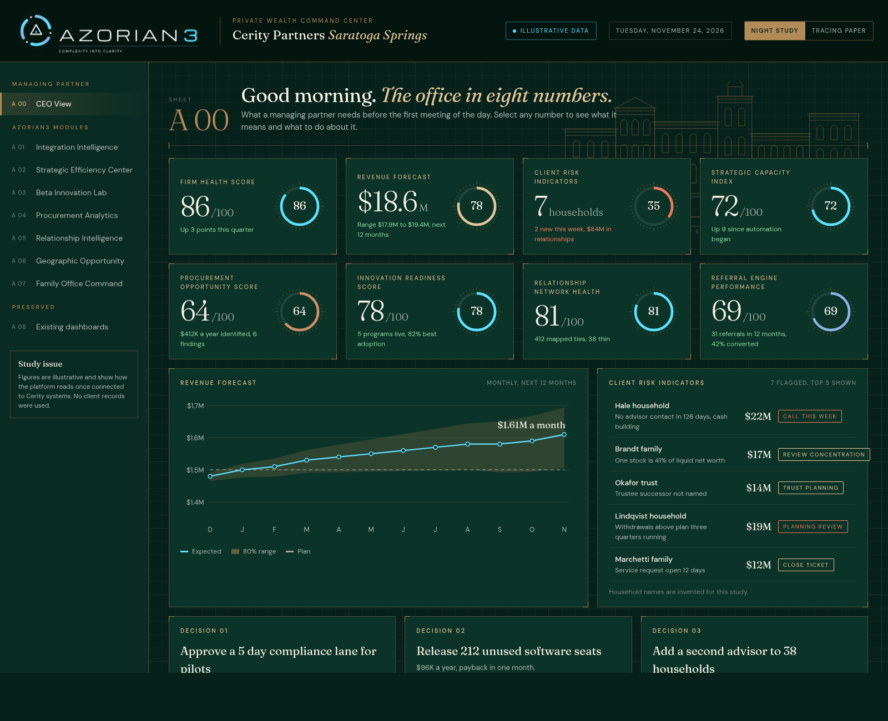

# Cerity Partners Private Wealth Command Center

Prepared by Azorian3 for the Cerity Partners Saratoga Springs office.

## What is here

| File | What it is |
| --- | --- |
| `index.html` | The full dashboard in one file. No build step and no server needed. |
| `how-to-video.mp4` | A 1 minute 40 second narrated walkthrough. |
| `preview.png` | Screenshot of the CEO View. |
| `_headers` | Makes Netlify serve the page correctly. Ignored by GitHub. |
| `.nojekyll` | Lets GitHub Pages serve the folder as is. |

## How to open it

- On your computer: download `index.html` and open it in Chrome or Edge.
- As a link: turn on GitHub Pages for this repository (Settings, Pages, deploy from the main branch, root folder). The dashboard then opens at the Pages address.

## What the dashboard contains

- CEO View: the office in eight numbers, the revenue forecast, households that need attention and three decisions for the week.
- Integration Intelligence
- Strategic Efficiency Center
- Beta Innovation Lab
- Procurement Analytics
- Relationship Intelligence
- Geographic Opportunity
- Family Office Command Center
- Existing dashboards: links back to what the office already uses.

Select any number, row, room or name to open a panel that says what it means and what to do. The switch in the top right changes between the dark Night Study look and the light Tracing Paper look.

## Data

Every figure and household name is illustrative. Nothing here comes from Cerity systems or client records.
